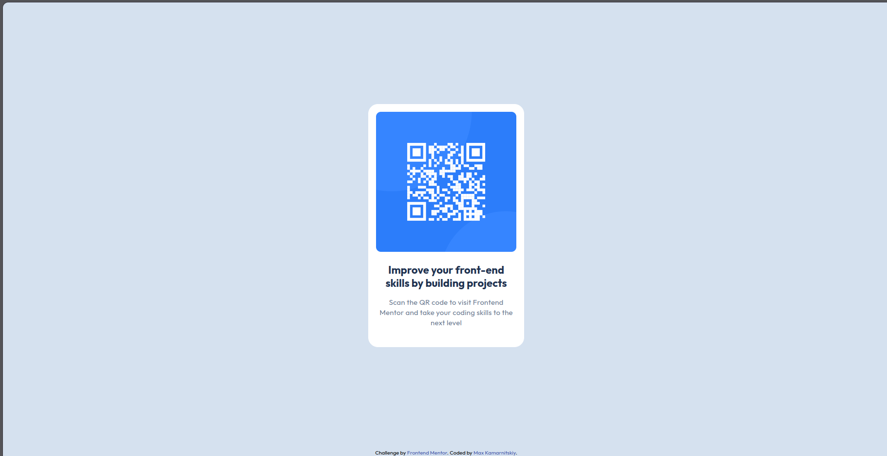

# Frontend Mentor - QR code component solution

This is a solution to the [QR code component challenge on Frontend Mentor](https://www.frontendmentor.io/challenges/qr-code-component-iux_sIO_H). Frontend Mentor challenges help you improve your coding skills by building realistic projects. 

## Table of contents

- [Обзор](#обзор)
  - [Screenshot](#screenshot)
  - [Ссылки](#ссылки)
- [Разработка](#разработка)
  - [Что использовал](#что-использовал)
  - [Что я узнал](#что-я-узнал)
  - [Что планирую изучить](#что-планирую-изучить)
  - [Использование ИИ](#Использование-ии)
- [Автор](#автор)

## Обзор

### Screenshot



### Ссылки

- Solution URL: [Add solution URL here](https://your-solution-url.com)
- Live Site URL: [Add live site URL here](https://your-live-site-url.com)

## Разработка

### Что использовал

- HTML5
- CSS3
- Flexbox
- Методология БЭМ
- Валидация кода на https://validator.w3.org

### Что я узнал
Повторил способы подключения сторонних шрифтов. Вспомнил как стилизовать элементы с помощью классов. Были некоторые проблемы с именованием классов по БЭМ (надеюсь, я справился).

Возник выбор между:

```html
<article class="qr-card">
        
        
        <div class="qr-card__content">
          <h2 class="qr-card__title">
            Improve your front-end skills by building projects
          </h2>
          
          <p class="qr-card__text">
            Scan the QR code to visit Frontend Mentor and take your coding skills to the next level
          </p>
        </div>
      </article>
```
и
```html
<figure>
          
          
          <figcaption>
            <strong>
              Improve your front-end skills by building projects
            </strong>
            
            <span>
              Scan the QR code to visit Frontend Mentor and take your coding skills to the next level
            </span>
          </figcaption>
        </figure>
```
Всё-таки, правильнее было использовать article.
### Что планирую изучить

Далее планирую продолжать обучение. Постепенно улучшать навыки, повышать уровень знаний. 

### Использование ИИ
Пока что я не использовал встроенного в VSCode ИИ-помощника. Но я консультировался с Gemini В некоторых вопросах: дполнительное ревью кода, нюансы при подключении шрифтов, обсуждение архитектурных вопросов вёрстки, выявление недочётов в именах классов

## Автор

- Frontend Mentor - [@MaksimKamarnitskii](https://www.frontendmentor.io/profile/MaksimKamarnitskii)